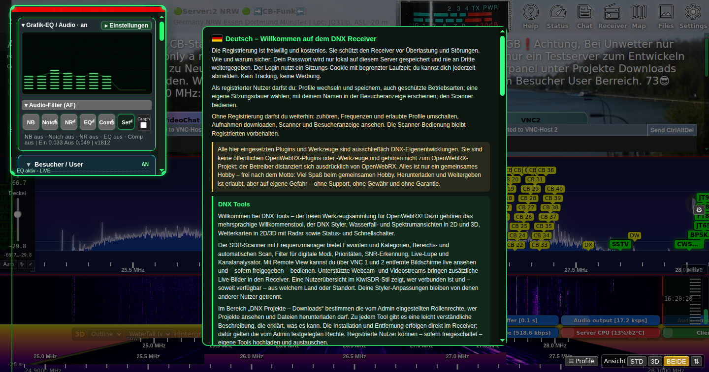

# DNX Receiver Welcome-Tool (`v1.1.0`)

<!-- DNX-DISCLAIMER-START -->
> **Wichtiger Hinweis / Vollständige Distanzierung (Hobby-Mod-Mode)**
>
> - **Vollständige Distanzierung:** Ich distanziere mich in jeder Hinsicht vollständig vom Projekt **OpenWebRX / OpenWebRX+** sowie dessen Entwicklern und Betreibern. Es besteht keinerlei Verbindung, Zusammenarbeit, Prüfung, Befürwortung oder Partnerschaft.
> - **Keine öffentlichen/offiziellen OpenWebRX-Plugins (nur Mod-Mode):** Bei diesem Projekt handelt es sich ausdrücklich **nicht** um ein öffentliches oder offizielles Plugin von OpenWebRX, sondern ausschließlich um einen privaten, inoffiziellen **Mod-Mode** (Eigenmodifikation).
> - **Warum bewusst kein reines Browser-JavaScript (Mod-Mode-Architektur):** Viele Funktionen (z. B. serverseitige Speicherung, Konten-/Rollenverwaltung, Profil-Synchronisation, VNC-/websockify-Brücken, geschützte Schnittstellen, Docker-/Systemintegration und stabile UI-Anpassungen) lassen sich sauber und sicher nicht allein über simples Client-JavaScript umsetzen, ohne den OpenWebRX-Kern umzubauen oder Browsergrenzen zu umgehen. Deshalb setzt dieses Projekt bewusst auf getrennte Begleitmodule, Shell-Installer und Dienste im **Mod-Mode** statt alles künstlich in reines JavaScript zu pressen.
> - **Kein öffentlicher Support & keine Haftung:** Es gibt **keinen öffentlichen Support**, keine Garantie und keine Haftung. Nutzung, Installation und Anpassung erfolgen vollständig auf eigene Gefahr (immer vorher Backups anlegen und zunächst im eigenen Testsystem prüfen).
> - **Reines Hobbyprojekt – frei nutzbar, änderbar & verbreitbar:** Dieses Projekt entsteht ausschließlich aus reinem Hobby und Interesse am gemeinsamen Funk-/SDR-Hobby. Es steht ausdrücklich frei zur Verfügung und darf frei genutzt, weiterverbreitet, verändert und verbessert werden.
<!-- DNX-DISCLAIMER-END -->

<!-- DNX-PREVIEW-START -->
## Live-Vorschau

<!-- DNX-PREVIEW-END -->

## Kurzbeschreibung

Mehrsprachiges Begrüßungsfenster für OpenWebRX+ (DE/EN/RU/NL mit SVG-Flaggen sowie UA, ES, ZH, JA, KO, VI, TH) inklusive Registrierungs- und Nutzungs-Hinweisen.

## Details

Begruessungsfenster DE/EN/RU/NL fuer den OpenWebRX-Receiver: erklaert die freiwillige Registrierung (wie und warum sicher), Rechte Registrierter, Rechte ohne Registrierung. Scanner-Bedienung nur eingeloggt.

## Weitere Dokumentation

Siehe [`README-WELCOME.txt`](README-WELCOME.txt) im Repository.

## Changelog

Erstimport

---

## Verbindungen im DNX-Ökosystem

* **Verbindung zu `DNX-Receiver-Account-Control` (`:8095/:8096`) & `DNX-Styler` (`:8098`):** Das mehrsprachige Begrüßungsfenster verweist Besucher direkt auf Registrierung/Anmeldung, die geltenden Rollenrechte sowie die geteilten Styler-Vorlagen (`styler-willkommen-vorlagen.png`).
